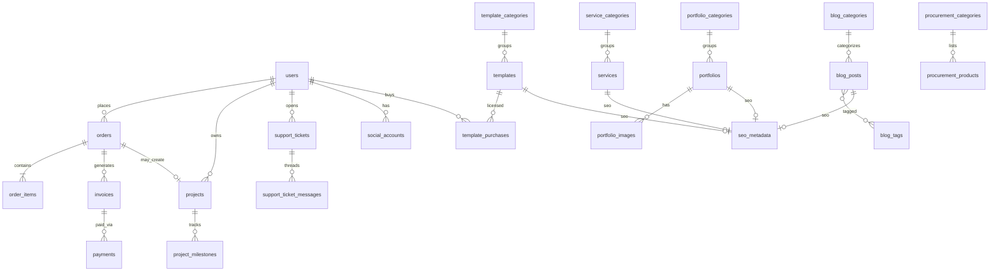

# Database ERD — LaksanaTech.id

## Entity Relationship Overview

## Core Tables

| Table | UUID | Soft Delete | Notes |
|-------|------|-------------|-------|
| users | Yes | Yes | Roles via Spatie |
| services | Yes | Yes | Service types enum |
| templates | Yes | Yes | Marketplace products |
| orders | Yes | Yes | Multi-type orders |
| invoices | Yes | Yes | PDF path ready |
| payments | Yes | No | Gateway abstraction |
| projects | Yes | Yes | Customer projects |
| portfolios | Yes | Yes | Published flag |
| blog_posts | Yes | Yes | Author = users |
| faqs | Yes | No | CMS FAQ |
| procurement_products | Yes | Yes | IT catalog |
| seo_metadata | — | No | Polymorphic |
| audit_logs | Yes | No | Change tracking |
| payment_webhooks | — | No | Raw webhook log |

## Migration Files

1. `0001_*` — Laravel default users, cache, jobs
2. `2026_06_02_155227_*` — Spatie permissions
3. `2026_06_02_160000_*` — User extensions, social, audit
4. `2026_06_02_160100_*` — Catalog & content
5. `2026_06_02_160200_*` — Commerce & support

## Seeders

| Seeder | Purpose |
|--------|---------|
| `RoleAndPermissionSeeder` | super_admin, admin, sales, customer + default admin |
| `LaksanaContentSeeder` | Services, portfolio samples, FAQs |

Default admin: `admin@laksanatech.id` / `password` (change in production).
